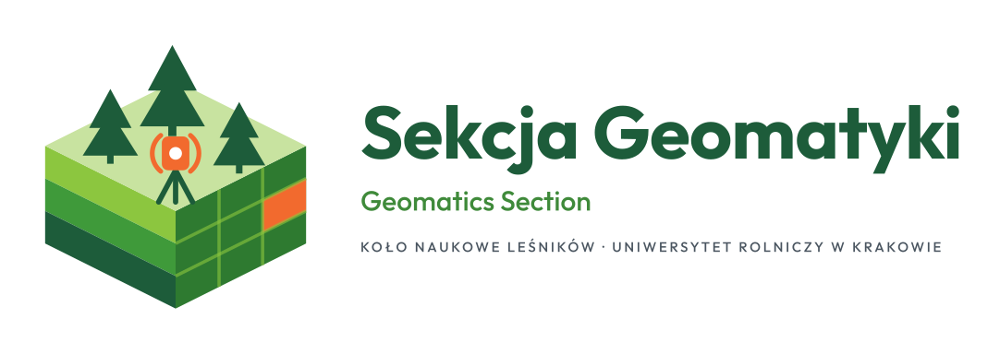

::: {.sekcja-naglowek}
{alt="Logo Sekcji Geomatyki Koła Naukowego Leśników Uniwersytetu Rolniczego w Krakowie" .nolightbox}
:::

::::: {.biogram}
::: {.content-visible when-profile="pl"}
Sekcja Geomatyki działa w ramach Koła Naukowego Leśników Uniwersytetu Rolniczego im. Hugona Kołłątaja w Krakowie. Skupia studentów zainteresowanych zastosowaniem geoinformatyki i teledetekcji w leśnictwie.

Od 2024 roku jestem opiekunem Sekcji.
:::

::: {.content-visible when-profile="en"}
The Geomatics Section is part of the Forestry Students' Scientific Association (Koło Naukowe Leśników) at the University of Agriculture in Krakow. It brings together students interested in applying geoinformatics and remote sensing in forestry.

I have been the supervisor of the Section since 2024.
:::
:::::
